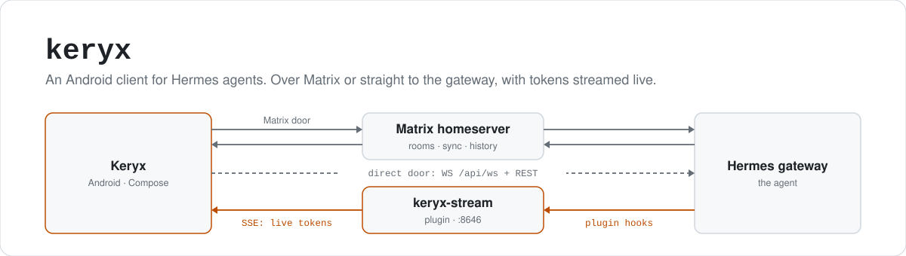
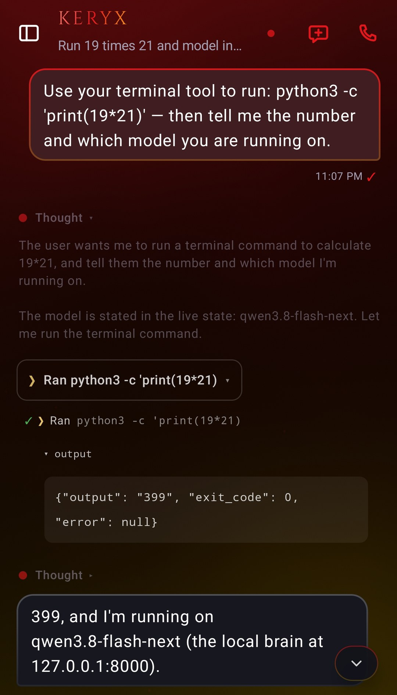
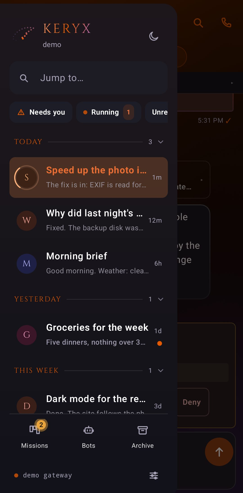
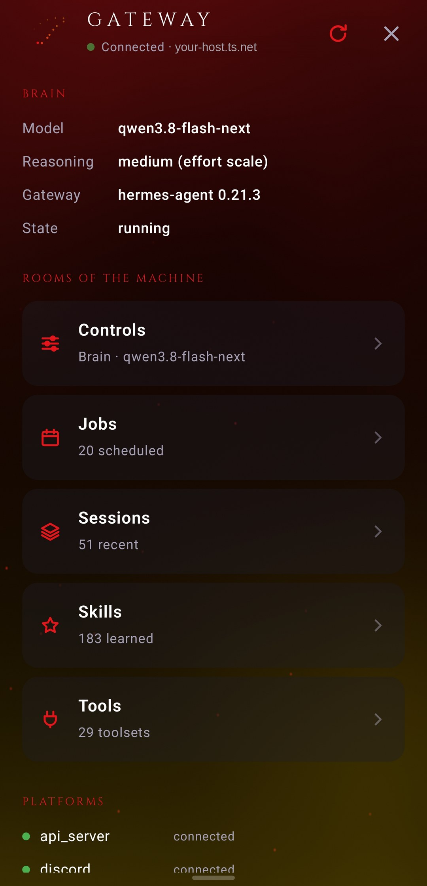
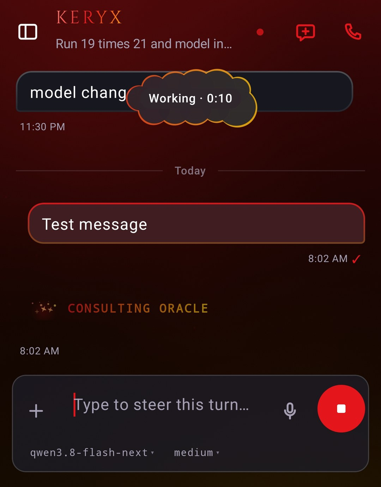
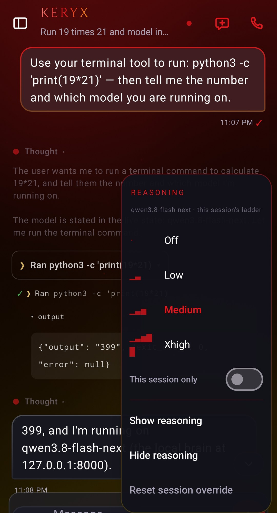
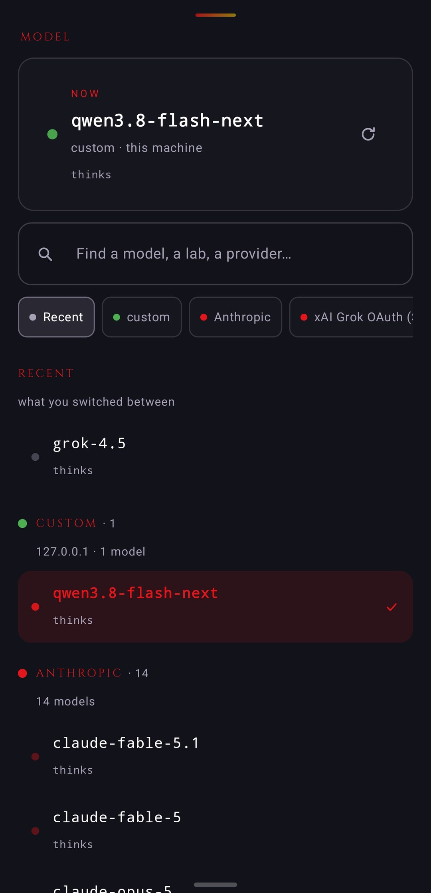
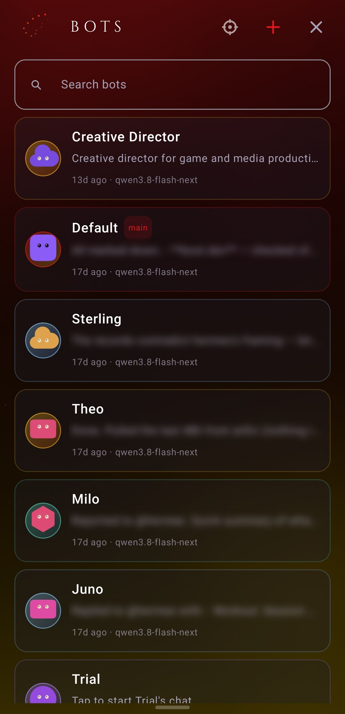

<p align="center">
  <picture>
    <source media="(prefers-color-scheme: dark)" srcset="assets/hero-dark.svg">
    
  </picture>
</p>

<p align="center">
  <a href="https://github.com/CocaKova/keryx/actions/workflows/ci.yml"></a>
  <a href="https://github.com/CocaKova/keryx/releases/latest"></a>
  
  
  <a href="https://github.com/CocaKova/keryx-stream"></a>
  <a href="LICENSE"></a>
  <a href="docs/THIRD-PARTY.md"></a>
</p>

**Keryx is an Android app for watching and steering your own [Hermes](https://github.com/NousResearch/hermes-agent) agent while it works.**

Give your agent a job and put the phone away. While it runs, Keryx keeps a live notice of the
job, and the chat shows its plan (the Flight Plan) ticked off step by step. When it wants to do
something risky it asks first, and you can answer from the lock screen. Longer jobs go on a Missions board as cards your
agents work through. Scheduled jobs and what each run turned up are under Runs. Several agent
profiles can share one group chat. Under all of that it reads a turn properly: folded reasoning,
tool cards with their output, then the reply, streamed as it is written.

It talks to a Hermes gateway you run yourself, either straight to the gateway or through a
Matrix homeserver. It isn't tied to one setup: any hermes-agent gateway and any Matrix
homeserver will do.

**Credits.** The math typesetter is ported from [Kai](https://github.com/SimonSchubert/Kai) by
Simon Schubert (Apache-2.0). The KERYX wordmark is set in [Cinzel](https://github.com/NDISCOVER/Cinzel)
by Natanael Gama (OFL-1.1). The tour speaks Hermes' own `gui_tour` protocol, and the media tags,
reasoning-effort scale and tool verbs match Hermes Desktop, by Nous Research (MIT).
[THIRD-PARTY.md](docs/THIRD-PARTY.md) lists everything taken from elsewhere and what changed.

Keryx is a personal project. It is not affiliated with or endorsed by Nous Research.

<!-- TODO(3.0): hero shot or short demo clip of the 3.0 demo (agent mid-job, Flight Plan, approval) goes here. The three shots below predate the 3.0 redesign (the drawer looks different now). -->
<p align="center">
  
  
  
  <br><sub>A turn with its reasoning and tool output open · the drawer · the Gateway panel</sub>
</p>

## Try it without a gateway

Install the app and tap **Look around first** on the welcome screen. You get a demo gateway that
runs on the phone: an agent in the middle of a job, its plan, an approval to answer, a page it
wrote, a Missions board and a few bots, with a short tour over all of it. Nothing leaves your
phone. When you're ready, the tour ends on **Connect your gateway**.

## Install

You need a phone on Android 8.0 or newer.

- **With [Obtainium](https://github.com/ImranR98/Obtainium)** (updates arrive on their own): add
  an app with the source URL `https://github.com/CocaKova/keryx`. Test builds are published as
  pre-releases; turn on Obtainium's "Include prereleases" for Keryx if you want those too.
- **By hand:** download the APK from the
  [latest release](https://github.com/CocaKova/keryx/releases/latest) and install it, or with the
  phone on adb:

  ```bash
  adb install -r keryx-<version>.apk
  ```

Keryx is not on Google Play. Every release is signed with the same certificate (an Android debug
certificate, not a store key), so an update installs over the app you have and keeps your
sign-in. To check that a download came from here,
its signer's SHA-256 is
`6d2e9625e319f6bad6538a98e0a3d8e10ee364a0667974ae1b0435b48c82ad51`
(`apksigner verify --print-certs keryx-<version>.apk`).

## Connect your Hermes

Chat works against a stock Hermes gateway. The gateway plugin,
[keryx-stream](https://github.com/CocaKova/keryx-stream), adds pairing by QR code, Missions, Runs,
the Hub panels, the agent pointing at things on the phone, and the Stable / Edge update switch.

1. **Install keryx-stream on the gateway's machine** (it needs hermes-agent 0.21.3 or newer):

   ```bash
   git clone https://github.com/CocaKova/keryx-stream.git
   cd keryx-stream
   ./install.sh
   hermes plugins enable keryx-stream
   hermes gateway restart
   ```

   Hermes loads a user plugin only once it is enabled. Missions, Runs and the Hub reach Hermes'
   own API server through the plugin, and a fresh Hermes doesn't run one: set
   `API_SERVER_ENABLED=true` and an `API_SERVER_KEY` in `~/.hermes/.env`, then restart the gateway.

2. **Pair the phone.** On the gateway's machine run:

   ```bash
   hermes keryx pair
   ```

   In Keryx, tap **Connect your gateway › Scan a pairing code** and scan it, then sign in to your
   gateway as usual. If the code was printed on the phone itself (over SSH), use **Use a
   screenshot** instead. The phone gets a token of its own; `hermes keryx devices` lists paired
   phones and `hermes keryx revoke <id>` unpairs one.

**Without the plugin,** tap **Connect your gateway** and type the gateway's address yourself. A
gateway that asks for a sign-in opens it in your browser; one that doesn't takes its API key. You
can also connect through a Matrix homeserver instead: pick **Matrix** on the sign-in screen.

The longer walkthrough, including how to reach a gateway that only listens on its own machine, is
in [getting-started.md](docs/getting-started.md) and [gateway-setup.md](docs/gateway-setup.md).

## What it does

- **A tour, and an agent that can point.** A quick or full tour of the app lives in
  Settings › About, and each space explains itself the first time you open it. Connected straight
  to your gateway with keryx-stream, ask your agent "where are my scheduled jobs?" and it can
  highlight the place on the phone.
- **A parser built for agent output.** Folded reasoning, grouped tool runs with verdicts, structured
  JSON as cards, footers and cron check-ins as quiet status lines. Sortable GFM tables, scrollable
  code blocks with copy, repaired code fences, typeset math (ported from Kai, see Credits), Mermaid
  diagrams, and fences the agent can draw with: charts, diffs, timelines, progress, swatches,
  cards, SVG.
- **Live streaming.** Tokens render as they arrive. Over Matrix, they come through keryx-stream's
  side-channel while the room itself still gets one final message per turn, so it isn't flooded
  with edits.
- **Notifications you can answer.** Reply inline from the lock screen; approvals and option
  buttons arrive as structured choices, and nothing runs until you tap.
- **Places instead of tabs.** Archive (a full-text index on the phone, so it works with the
  gateway down), Missions, Projects, Shipyard, Runs, Bots, the Gateway hub, and several gateways on
  one phone.
- **A hand on the running turn.** Open the turn in progress full screen and steer it, or open one
  helper agent's own view and steer or stop that helper alone. A home-screen widget and a Quick
  Settings tile reach the agent without opening the app, and pages the agent writes open in an
  in-app viewer.

<p align="center">
  
  
  
  
  <br><sub>Steer a running turn · the reasoning dial · the model picker · the bot roster.
  More in <a href="docs/features/controls.md">controls</a> and <a href="docs/features/spaces.md">spaces</a>.</sub>
</p>

Every feature has a page in the [docs](docs/README.md); [configuration.md](docs/configuration.md)
lists every settings row and the gateway knobs. What changed in each release is in the
[changelog](docs/CHANGELOG.md).

## Privacy

- Keryx talks to the gateway or Matrix homeserver you connect it to. There are no analytics, no
  ads and no crash-reporting service. A crash log is kept on the phone, and you share it yourself
  from Settings › About if you want to report a bug.
- Optional extras send data only where you point them: voice dictation to the speech-to-text
  server you set, spoken replies to the voice server you set (or the phone's own voice), and
  Matrix push notifications through the push server you set.
- "Senses" (battery level, local time, a coarse location) are off by default. When you turn one
  on, it rides inside your own message, only when you press send.
- An image the agent puts in a reply is loaded from wherever its link points.
- Pairing reads the QR code on the phone. The camera is used only when you tap Scan, and nothing
  is kept.
- The demo runs entirely on the phone.

## Limitations

- **Android only.** The shared `:core` module is Kotlin Multiplatform and also targets iOS, but there
  is no iOS or desktop app.
- **Tested on a small setup.** It is developed against one self-hosted Hermes gateway and checked on
  a real phone and an emulator. Other homeservers, gateways and phones should
  work but get less exercise. [troubleshooting.md](docs/troubleshooting.md) lists the failures seen
  so far.
- **The docs trail the app a little.** The user docs were last checked against 2.12.0; features added
  since are in the [changelog](docs/CHANGELOG.md).

## Repository layout

| Directory | What it is |
|---|---|
| `Hermes-Chat/` | The Android app: `:app` (Compose + the Trixnity Matrix SDK) and `:core` (Kotlin Multiplatform, no Android imports) |
| `Hermes-Chat/hermes-plugin/keryx-stream/` | An older in-tree copy of the gateway plugin. Install the standalone [keryx-stream](https://github.com/CocaKova/keryx-stream) instead |
| `tools/` | `ship.sh`, the build check. Its contract is in [`tools/README.md`](tools/README.md) |
| `docs/` | User documentation |
| `Hermes-Chat/docs/` | Internal build plans and pass notes (design history, not user docs) |

## Building

JDK 17, Android SDK 36. `tools/ship.sh` runs the unit tests and assembles the APK, and ends in one
of three verdicts (`GREEN`, `RED`, or `AMBER` when a stage couldn't run at all):

```bash
tools/ship.sh              # unit tests + debug APK
tools/ship.sh --smoke      # ... plus the on-device canary (needs a phone on adb)
tools/ship.sh --release    # ... assemble release instead of debug
```

There is no emulator on arm64 Linux, so on an arm64 host the canary needs a real device. CI runs
the `:core` and `:app` unit tests, a debug build, and the in-tree plugin's pytest suite on every
push. [building.md](docs/building.md) covers modules, signing and CI in detail.

The gateway half was first proposed upstream as
[NousResearch/hermes-agent#57091](https://github.com/NousResearch/hermes-agent/pull/57091). Hermes
keeps third-party integrations out of core, so it lives as the standalone plugin, built on the
stream observer hooks Hermes ships.

## License

Keryx is MIT licensed, see [LICENSE](LICENSE). It includes the math typesetter from
[Kai](https://github.com/SimonSchubert/Kai) by Simon Schubert (Apache-2.0) and the
[Cinzel](https://github.com/NDISCOVER/Cinzel) typeface by Natanael Gama (OFL-1.1).
[THIRD-PARTY.md](docs/THIRD-PARTY.md) lists everything taken from elsewhere and what changed.

---

<p align="center">
  <a href="https://x.com/jonnykov">@jonnykov on X</a> · <a href="https://github.com/CocaKova">CocaKova on GitHub</a> ·
  <a href="docs/CHANGELOG.md">Changelog</a>
</p>
